# Adaptive Cooling (ac-adaptive) Implementation Guide

This guide sets up **ac-adaptive** for floor 2: the number of people in the room decides the air conditioner's temperature and fan speed. It is delivered as one counting package and one control package per room, and every live change needs the user's approval.

> Current status and progress: [status.md](status.md) and [plan-and-test.md](plan-and-test.md). This guide describes how the system works and how to install, test and tune it.

## How it works

```mermaid
flowchart LR
    F[Frigate: floor 2 occupancy] --> O[binary_sensor.ac_lt2_occupied]
    O --> C[Count automation: every 10 min and when the floor fills]
    C --> G[Gemini AI Task: count people in the camera frame]
    G --> P[sensor.ac_lt2_people]
    O --> P
    P --> L[Level 0..3 per AC: left, middle, right]
    L --> R[Recommended temperature and fan per AC]
    R -.after separate live approval per AC.-> A[Control package: left, middle, right]
    A --> S[Per-unit switch, guards and shared script]
    S -.-> W[Check the AC's power sensor]
```



* **Frigate** only says whether the floor is occupied. Its own people count is not used because it under-counts seated people (evidence: [decisions.md](decisions.md)).
* **Gemini** counts the people in a frame from the floor camera and returns `count`, `confidence` and `observation`. Answers below 70 confidence are discarded.
* **The automation, not Gemini, decides.** The level and the recommended setting are template sensors. All numbers sit in one `variables:` block marked `SETTINGS` in the package, **one entry per AC** (left, middle, right), so each AC has its own people ranges, temperatures, fans and temperature limits.
* **The count package** (`adaptive_cooling_lt2.yaml`) only computes and shows the recommended setting for all three ACs. It never calls a `climate` service. **The control package** (`adaptive_cooling_lt2_control.yaml`) sends it to any of the three units; each unit has its own switch, helpers and thin automation, while the guards and the two IR calls live once in `script.ac_lt2_apply_setting`. The control package is optional, needs its own install approval, and every switch starts off on a fresh install.

## Safe defaults

| Situation | Behaviour |
|-----------|-----------|
| Room empty (occupancy off for 15 minutes) | Level 0, energy-saving setpoint (27 C / High) is shown, but the control package sends **nothing** while the room is empty, so the AC keeps its last setting. The pilot never turns an AC off |
| Latest accepted count older than 30 minutes while occupied | The safe level (`stale_level`, 2 = normal) and the `stale` attribute is true |
| Gemini fails or answers below 70 confidence | Nothing is written; the last accepted count stays |
| Gemini answers 0 while Frigate's raw occupancy sensor is still `on` | Treated as a bad frame: nothing is written; the last accepted count stays. Confidence does not catch this (a 0 came back with confidence 100 on 2026-10-29) |
| Count automation switch (`input_boolean.ac_adaptive_count_enabled`) is off | No Gemini calls at all. It is off after install |
| Outside `schedule.ac_adaptive_hours` (now Mon-Fri 07:00-18:00) | No Gemini calls |

The people value is the **latest accepted answer**. `prev` is kept only as history. Using one value avoids the 2026-10-29 bug where a partially updated pair dipped to 2 people and sent 26 C.

## Files

| File in this repo | Goes to on Home Assistant |
|-------------------|---------------------------|
| `packages/adaptive_cooling_lt2.yaml` | `/homeassistant/packages/` |
| `packages/adaptive_cooling_lt2_control.yaml` | `/homeassistant/packages/` only after separate approval; one file for left, middle and right, each unit switched on separately |

The package creates its own helpers (an input boolean, numbers, a datetime, a text and a schedule), so no helper has to be created by hand.

## Steps

### 1. Prerequisites (read-only)

**Who:** the agent reads; you confirm the room.

* HA 2026.7 or newer with packages enabled (`packages: !include_dir_named packages`; already set on this site).
* A Frigate camera for the room and `binary_sensor.2nd_floor_person_occupancy`.
* The primary AI Task `ai_task.google_ai_task`.
* The ACs for the room as `climate.*` entities, each with a power sensor.

### 2. Test the people count

**Who:** the agent runs it after your explicit approval; you say how many people are really present.

This saves nothing and costs 3 Gemini calls per run. It compares the Gemini count with the real count for `camera.2nd_floor` (floor 2 has one physical camera, so `camera.cctv_lt2`, the recorder's feed, is presumed to show the same view):

```bash
python tools/count_people_test.py --confirm-approved 3 <real head count> camera.2nd_floor
```

A run passes when at least 2 of the 3 answers are within 1 of the real count. The package uses the latest accepted answer and ignores bad frames (low confidence, or 0 while Frigate still sees people). The result also feeds the level thresholds. If a run fails, stop and revisit [decisions.md](decisions.md). Results so far: [plan-and-test.md](plan-and-test.md) phase 2.

### 3. Set the levels and setpoints

**Who:** you and the agent. Set on 2026-10-29 with the user: floor 2 usually has 4 people on a working day, and the room already feels cold, so the numbers are low. They are a hypothesis to test in the pilot, not settings proven comfortable.

The people count is one number for the room. Each AC turns it into its own level using its own ranges, so the three ACs can differ. At the start all three use the same numbers:

| Level | Name | People | Recommended temperature | Recommended fan |
|-------|------|--------|-------------------------|-----------------|
| 0 | empty | none for 15 minutes | 27 C | High |
| 1 | few | 1 (a count of 0 while the 15-minute hold is still on also counts as few) | 22 C | High |
| 2 | normal | 2 to 3 | 20 C | High |
| 3 | busy | 4 or more | 18 C | High |

The fan is High at every level; only the temperature changes. Floor 2 usually has 4 people, which is level 3. Because the latest answer is used, an answer of 3 or 5 moves the target immediately; that is deliberate, so the AC follows the room.

The three ACs (names in the package are English, the site calls them kiri, tengah and kanan):

| Position | AC | Climate entity | Temperature limits |
|----------|----|----------------|--------------------|
| `left` | Sharp (kiri) | `climate.ac_sharp_lt_2_kiri` | 18 to 30 C |
| `middle` | Sharp (tengah), first pilot AC | `climate.ac_sharp_lt_2_tengah` | 18 to 30 C |
| `right` | LG (kanan) | `climate.ac_lg_2_2` | 16 to 30 C |

**Where to change them:** in `packages/adaptive_cooling_lt2.yaml`, the `variables:` block under the comment `SETTINGS`. It has an `ac_settings:` entry for each AC (`left`, `middle`, `right`) with these keys:

| Key | Meaning | Now |
|-----|---------|-----|
| `entity_id` | the AC's climate entity, used by that unit's control automation and its `recommended_setting` sensor | see table above |
| `few_max` | highest head count still "few" | 1 |
| `normal_max` | highest head count still "normal"; above it is "busy" | 3 |
| `temperature` | temperature for levels `[empty, few, normal, busy]` | `[27, 22, 20, 18]` on all three |
| `fan` | fan for the same levels (the AC's own fan names) | `[High, High, High, High]` |
| `min_temp`, `max_temp` | the AC's own limits; a recommendation is kept inside them | 18 and 30 (Sharp), 16 and 30 (LG) |

Two more settings apply to all ACs: `stale_minutes` (30) and `stale_level` (2).

Example: for the middle AC to call 6 people "normal", set `normal_max: 6` under `middle`; left and right do not change. After editing the installed file, run the configuration check and reload **Template entities**.

Entities it creates (all names in English):

| Entity | Meaning |
|--------|---------|
| `binary_sensor.ac_lt2_occupied` | floor 2 occupied (Frigate, held 15 minutes) |
| `binary_sensor.ac_lt2_count_stale` | occupied, but the last accepted count is older than `stale_minutes` |
| `sensor.ac_lt2_people` | people on floor 2 (latest accepted count, 0 when empty) |
| `sensor.ac_lt2_<position>_level` | level 0 to 3 for that AC |
| `sensor.ac_lt2_<position>_recommended_temperature` | recommended temperature; attribute `level_name` (empty, few, normal, busy) |
| `sensor.ac_lt2_<position>_recommended_fan` | recommended fan |
| `sensor.ac_lt2_<position>_recommended_setting` | one atomic target `<temperature>|<fan>` that the control package sends for that unit |

`<position>` is `left`, `middle` or `right`.

Display names in Home Assistant use the short prefix **AC LT2**. In Activity, the
most useful targets are **AC LT2 People** (`sensor.ac_lt2_people`), **AC LT2
Counted at** (`input_datetime.ac_lt2_count_time`), **AC LT2 Middle sent**
(`input_text.ac_lt2_middle_last_applied`), **AC LT2 Middle sent at**
(`input_datetime.ac_lt2_middle_last_command`), **AC LT2 Middle manual at**
(`input_datetime.ac_lt2_middle_last_manual`) and **AC LT2 Middle control**
(`input_boolean.ac_lt2_middle_control_enabled`). Left and right follow the same
pattern. Two kinds of "target" exist: **AC LT2 `<Position>` target** is the
recommendation (a template sensor), and **AC LT2 `<Position>` sent** is the setting the
automation last sent to that AC (an `input_text`). The entity IDs and automation
aliases do not change when these display names change.

Notes:

* Sharp's lowest setpoint is 18 C, so the busy level sits at its floor; LG can go down to 16 C. A recommendation is clamped to each AC's `min_temp` and `max_temp`.
* The fan names are the ACs' own (`Auto`, `Low`, `Medium`, `High` for the Sharp ACs and for `climate.ac_lg_2_2`); check them against each entity's `fan_modes` before control is added.
* The input helpers (last counts, time, note) have no `initial:`, so an HA restart does not erase the last accepted count. After a first install the count time is empty, so the count reads "stale" (the safe level 2) until the first count is accepted.

### 3b. Run the offline tests (before any install or YAML change)

**Who:** the agent. No live Home Assistant, Gemini or AC is touched. The "Home Assistant" here is the `homeassistant==2026.7.1` Python package in a Python 3.14 venv, started inside pytest; there is no server and no Docker. Set up once:

```bash
python3.14 -m venv .venv
.venv/Scripts/python -m pip install -r tests/requirements-test.txt   # Windows; use .venv/bin/python elsewhere
```

Then run the two commands below with that venv's Python.

```bash
python run.py check   # HA configuration check: count alone, then count + control
python run.py test    # all tests, with a fake camera, AI Task, climate services and power sensor
```

The tests cover the cases in [plan-and-test.md](plan-and-test.md) phase 5. They cannot show real Gemini answers, Broadlink delivery or the real power sensor's timing; those are checked during the pilot.

### 4. Install (both switches off)

**Who:** after you approve the scope, the agent saves a copy of any replaced file, installs the packages over SSH (`scp` to `/homeassistant/packages/`, then `sha256sum` on both sides; see [../credentials/README.md](../credentials/README.md)), runs the configuration check and reloads Input helpers, Schedules, Template entities, Scripts and Automations. Creating new helpers from a package needs a restart or the matching reloads; the agent states which one and asks if a restart is needed. A reload is enough when the files change; the one case where it is not is a stray subdirectory inside `/homeassistant/packages/` (see Troubleshooting).

After the install every switch is off: `input_boolean.ac_adaptive_count_enabled` plus `input_boolean.ac_lt2_left/middle/right_control_enabled`. The control package holds all three units; each has its own switch, helpers and automations, while the guards and the two IR calls live once in `script.ac_lt2_apply_setting`. Turning on the count switch starts the scheduled Gemini calls, so the agent asks before it does that. Installing the control package needs its own approval, and turning on one unit's switch is a separate approval for that named AC; middle and right were approved on 2026-10-29, left stays off until its plug reports again.

### 5. Live pilot (middle Sharp and right LG; left armed but off)

Finish the offline checks first. The control package creates `input_boolean.ac_lt2_middle_control_enabled` (plus `..._left_...` and `..._right_...`), **off** on a fresh install and restored to its last state after a restart because there is no `initial:`. Installation does not send AC commands. Enabling it (and enabling `input_boolean.ac_adaptive_count_enabled`, a separately approved step that sends staff frames to Google) starts the live pilot only after a recent accepted count. Ask for explicit approval before the first command to this named AC; confirm the result with the user beside the physical unit. All other ACs only show recommendations.

Each unit is handled by its own thin automation (`ac_lt2_left_apply`, `ac_lt2_middle_apply`, `ac_lt2_right_apply`) that calls the shared script with that unit's climate entity, power sensor, switch and helpers. The middle automation is described below; the other two differ only in entity, power sensor and temperature range (left Sharp 18-30, right LG 16-30). It requires `schedule.ac_adaptive_hours` to be on (now Mon-Fri 07:00-18:00 WIB), an occupied room, a count no older than 30 minutes, climate mode `cool`, and a power report (`last_reported`) less than 20 minutes old. A late report holds new commands instead of switching control off. It checks the Sharp fan mode and 18-30 C range, limits attempts to one per 10 minutes, and waits 60 minutes after a HA user changes the unit through the UI. A direct HA user change detected by its context **turns the control switch off** and clears the last automatic setting; `ac_lt2_manual_resume` turns that switch back on after 60 minutes, but only inside work hours. Power-check and deliberate switch-offs are not resumed. It never calls `climate.set_hvac_mode` or turns an AC on/off. The last **attempted** automatic setting is recorded in `input_text.ac_lt2_middle_last_applied` before sending IR; if the recommendation is unchanged, no new command is sent even after a service failure. Re-enabling the control switch clears that setting and allows a new attempt after the time gates. A physical IR remote is invisible to HA and cannot pause the automation; turn off the control switch manually after using one.

Temperature and fan are sent as two service calls. Broadlink IR cannot report actual temperature or fan, so the stored setting is a record of what HA attempted, not verification. After 15 minutes, if a **fresh** report shows at most 50 W, the control switch turns off and a persistent notification is created. A missing report never turns control off; it only holds new commands until a report arrives (checked every minute). The power sensor reports about every 10 minutes and can verify only on/off; it cannot prove either command reached the AC. The automation never retries an IR command automatically.

No command is issued when the control switch is off, the count switch is off, the room is empty, the count is stale, the power reading is missing/old, the climate mode is not `cool`, the recommendation is out of range, the previous attempt was within 10 minutes, or a detected HA manual change was within 60 minutes. To roll back, turn off the control switch first; remove the control package and reload its helpers and automations only after approval. The counting package is separate.

While the room is empty, and outside `schedule.ac_adaptive_hours`, the count package still shows level 0 or 2 but the control package issues no command ("room occupied" and the work-hours schedule are required). The AC therefore keeps whatever setting it had. Cooling an empty room is not the goal; turning a unit down by guessing is the risk the pilot avoids.

The ACs are controlled by Broadlink IR, which is one-way. Home Assistant cannot see a change made with the physical remote except its on/off power draw. During the pilot, compare the recommended setting with the physical unit and staff comfort, not just the dashboard state.

### 6. Extend

Only after the Sharp middle pilot succeeds and the user approves each named AC, extend to the other floor 2 ACs, then floor 1.

## Monitoring activity in the UI

Three built-in views, no extra entity needed. Use the display names (the `AC LT2` prefix), not entity IDs.

**Logbook** (Settings > Logbook). Filter by name:

| Name | Shows |
|------|-------|
| `AC adaptive - count people floor 2` | each count run and its trigger (time pattern, or the floor becoming occupied) |
| `AC LT2 Counting` | the count switch |
| `AC LT2 People` | the accepted count changing |
| `AC LT2 Counted at` | when the last count was accepted |
| `AC LT2 Occupied`, `AC LT2 Stale` | room occupancy and whether the count is older than 30 minutes |
| `AC floor 2 left/middle/right - apply people-based setting` | the per-unit decision runs |
| `AC LT2 - apply setting to one AC` | the shared script, i.e. every attempt including the ones a guard stopped |
| `AC floor 2 - arm the three units`, `... - record HA manual change`, `... - resume control 60 minutes after a manual change`, `... - check power after command` | re-arming, manual pauses and their work-hours resume, the 15-minute power check |

**History** (Settings > History). Add `AC LT2 People`, `AC LT2 Confidence`, `AC LT2 Note`, `AC LT2 People (last)`, `AC LT2 People (prev)`, the three recommendation entities (`AC LT2 Left target`, `AC LT2 Middle target`, `AC LT2 Right target`), the three sent settings (`AC LT2 Left sent`, `AC LT2 Middle sent`, `AC LT2 Right sent`), the three `... sent at` and `... manual at` timestamps, and the three `climate` entities.

**Traces** (Settings > Automations > pick one > the three-dot menu > Traces). This is the only UI view that shows *why* nothing was sent: every guard is listed with its result, so it shows the first failing condition (switch off, outside hours, not occupied, stale count, plug off, power report older than 20 minutes, not cooling, out of range, 10-minute cooldown, 60-minute manual pause, target already applied). Only the last 5 runs are kept and they are lost on restart.

Two things that look like faults but are not:

* **No new Logbook entry does not mean the count stopped.** Logbook records changes only; a second answer of the same number writes nothing. Check `AC LT2 Counted at` instead.
* **`AC LT2 - apply setting to one AC` runs about three times a minute**, one per unit, because each apply automation rechecks every minute (`time_pattern: /1`). The script stops at the first failing guard; no IR is sent.

Naming: `AC LT2 <Position> target` is the recommendation and `AC LT2 <Position> sent` is what was last sent to the AC, so no two entities share a display name (renamed 2026-10-30; before that `AC LT2 Left target` and `AC LT2 Right target` named two entities each, and the middle ones had no "Middle" in the name). In Activity, a `target` change "By automation: AC adaptive - count people floor 2" is a new recommendation; a `sent` change "By automation: AC floor 2 ... - apply people-based setting" is a command attempt.

## Dashboard and push notifications

**Dashboard `AC Adaptive`** (sidebar, url `/ac-adaptive-lt2`). The tab labels are the view titles, so the views carry no icon: the first tab `LT2` (`/ac-adaptive-lt2/lantai-2`) shows the existing cards and graphs and its header reads "AC Lantai 2"; the second tab `LT1` (`/ac-adaptive-lt2/lantai-1`) is deliberately empty until that floor is planned and approved. Source: `tools/build_dashboard.py` writes `dashboards/ac_adaptive_lt2.yaml`; `tools/push_dashboard.py --confirm` saves its views and updates the dashboard's sidebar title. Edit the builder, not the dashboard in the HA UI (a push replaces it). The design follows the mockup "Dashboard AC Lantai 2" (dark cards, rounded corners, a setpoint ring), with a sections view of up to three columns that stacks to one column on a phone. Top to bottom:

* header with the page title "AC Lantai 2" (no "Home Assistant" line) and chips (counting on or off, work hours 07-18, room occupied, date and time);
* four summary tiles, left to right: people now with level and "dihitung X menit lalu" ("data lama" when stale); average setpoint of the running ACs; automatic control (amber "Mati" plus the system's suggestion, or x/3 with the unit names); and, far right, room temperature and humidity from `sensor.0x84b4dbfffee9c73e_temperature` and `_humidity` as one row of two 30 px values with only the age under it ("5 hari yang lalu"; the age turns yellow after 3 hours; no room name and no "data lama" label), and `–` with "Sensor tidak tersedia" when unavailable. The "AC menyala" tile was removed on 2026-11-02;
* **one card per AC** (Sharp Kiri, Sharp Tengah, LG Kanan), as in the mockup: name and entity id on the left, a pill with the mode (COOL or OFF) on the right, a setpoint ring (50 px, "Mati" when off) with the mode label above the number and `Fan <speed>` below it. There is **no row of mode or fan chips**: the current mode and the current fan are each shown once. A short amber note appears **only when the AC differs from the target** (`sensor.ac_lt2_<position>_status` is not `ok`), for example "Otomasi mati · saran 26 °C · Low", "AC mati, tidak diatur otomasi", "Di luar jam kerja", "Menunggu hitungan orang", "Menunggu data daya AC", "Dijeda manual s/d 10:15", "Akan ke 18 °C · High (± 4 mnt)", "Terkirim, belum sesuai";
* a 24-hour chart (step lines for each AC, 176 px high, and hourly people bars, 150 px high) next to the activity timeline (the latest 6 of the 8 stored events from `sensor.ac_lt2_activity`; tapping it opens the Logbook, the only action on the page). Both are nested in one full-width button-card: its CSS grid gives the chart two thirds and activity one third and stretches both cards to equal height. A container query at 900 px stacks them into full-width rows when the available content width shrinks, including browser zoom. The two ApexCharts cards have no individual border or padding; the rounded outer chart border uses 14 px left/right padding and 18 px bottom padding. All three temperature series use one shared ApexCharts Y axis (not the `apexcharts-card` `yaxis:` option, which creates one axis per series and takes up plot width). Temperature and people charts have matching Y-label widths and left/right grid padding so their plot areas align. One shared time axis sits below the people bars, using ApexCharts' own datetime format `HH:mm` (24-hour, no date label) with 12 px labels and extra bottom spacing so they are not clipped. Do not replace it with a JavaScript formatter that only prints whole hours: ApexCharts may place ticks at times such as 11:20, and the whole axis then renders empty (2026-10-30). The legend shows the four names (Kiri, Tengah, Kanan, Orang) without values, and there are no end-of-line value labels: the current values are on the AC cards and the summary tiles above;
* the 7-day cards (peak people per day, settings sent per AC, "Tentang data ini") were removed from the page on 2026-11-02. `WEEK_JS` stays in `tools/build_dashboard.py` but is not placed in `build()`; `sensor.ac_lt2_activity` still records `people_peak_by_day` and `sent_by_day`, so the cards can be put back without a package change.

How it is built: the designed cards are `custom:button-card` with **no entity**; one custom field returns HTML from a JavaScript template that only reads `states[...]`. Because there is no entity, its default tap action cannot toggle anything, and every tap, hold and double-tap action is `none`. The chart is two `apexcharts-card` inside a `stack-in-card`, styled with `card-mod`. No resource, font or theme was added to HA (the system font is used). Text wraps instead of being cut (button-card puts `white-space: nowrap; overflow: hidden` on the field, which the cards override). Text sizes are fixed in px (at most 52 px for the setpoint) so they do not grow with the card width; the first version used `modern-circular-gauge`, which scaled its numbers to the card and looked oversized.

`sensor.ac_lt2_activity` (a trigger-based template sensor in the control package) stores the last 8 events, the settings sent per unit per day and the highest people count per day for 7 days. It keeps them across restarts and only records; it never calls a service. The 7-day cards fill from the day it was installed. The old `input_number.ac_lt2_<position>_changes` helpers still feed the 18:05 push.

Tests: `tests/test_dashboard_file.py` runs every JavaScript template with Node (`tests/js_runner.js`) against fake states, using a `hass` object that throws if touched, and checks the rendered text (only the active mode and fan, the amber note only when different, the peak sentence, the timeline). `tools/push_dashboard.py` refuses any `custom:button-card` with an entity or without explicit actions, any action other than `none`, `more-info` or `navigate`, and any JavaScript that mentions `callService`, `callWS`, `fetch(` and similar.

**Push notification** to `notify.mobile_app_cph2457` (the `notify_service` variable of the two automations in `adaptive_cooling_lt2_control.yaml`):

| Automation | Sends |
|------------|-------|
| `ac_lt2_notify_setting_sent` | "AC Sharp Tengah: 20 °C · Fan High", "Setelan dikirim pukul 09:50 untuk 3 orang di Lantai 2", one per AC with its own tag so a newer one replaces the older. Only for settings sent by the automation; nothing for `armed`, a manual change or a user's own edit |
| `ac_lt2_daily_summary` | one push 5 minutes after `schedule.ac_adaptive_hours` turns off (18:05 now); a day outside the schedule gets none. Settings sent per AC today and the last count; then `input_number.ac_lt2_<position>_changes` resets |

Tapping a push opens the dashboard. The wording is "dikirim" (sent), because IR cannot confirm that the AC changed.

**HA notification bell.** `ac_lt2_notify_setting_sent` also creates a `persistent_notification` with the same title and text as the push, with the fixed `notification_id: ac_lt2_adaptive` for all three ACs. A new setting therefore **replaces** the previous bell entry, so this feature never occupies more than one slot and other notifications are not buried. The price is that two ACs changing together leave only the last one in the bell; the push, the dashboard timeline and `sensor.ac_lt2_activity` keep the full history. `ac_lt2_check_power` keeps its own, separate notification (control paused).

## Privacy

Scheduled counts send a camera frame of the room to Google. Staff should be told. Frames are sent straight from the camera and are not stored by the package.

## Troubleshooting

* **HTTP 530 from `aj9.iotera.cc`:** the HA server is down; the tunnel has nothing behind it. Wait for the server.
* **The levels stay at 2 and `binary_sensor.ac_lt2_count_stale` is on:** no count was accepted for 30 minutes. Check the count switch, the schedule and the last answers' confidence.
* **A reload changes nothing: new entities do not appear, old automations keep running.** Look for a subdirectory inside `/homeassistant/packages/`. The site loads that folder with `!include_dir_named`, which needs files only; one directory there made every reload silently keep the old configuration on 2026-10-29. Move backups to `/homeassistant/_backup_*` and reload the domains again.
* **Count always low:** the camera may not see the whole room, or the model needs a better frame. Re-run step 2; if `camera.2nd_floor` (640x360 from Frigate, presumably) keeps under-counting, try `camera.cctv_lt2`, which pointed at the same room when checked on 2026-10-29 and may be sharper (resolution not checked).
